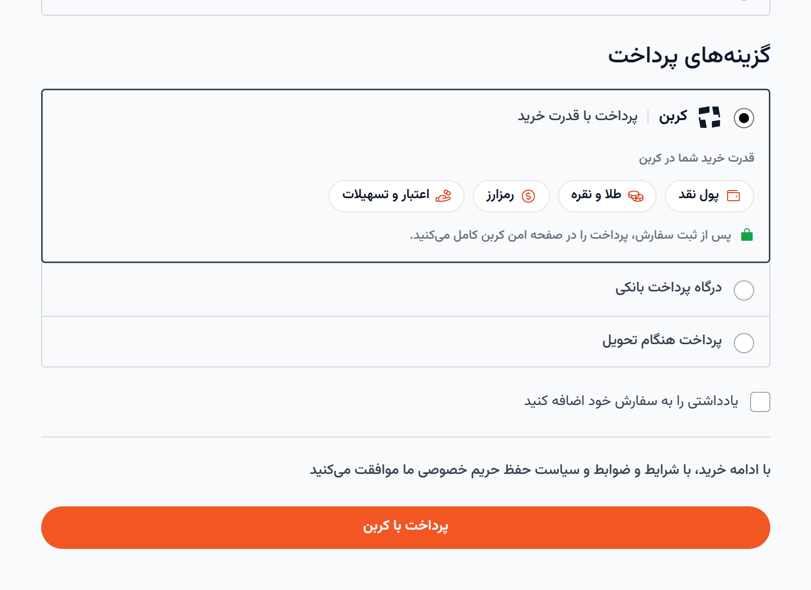
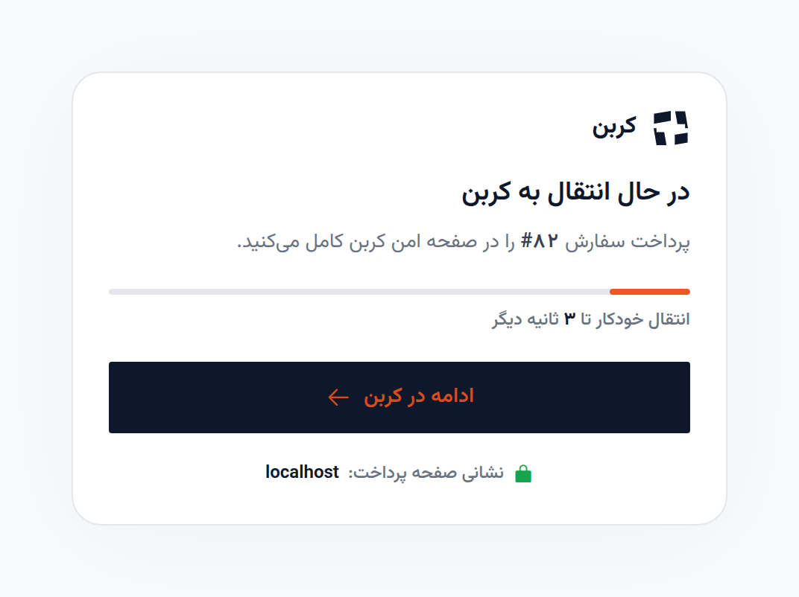
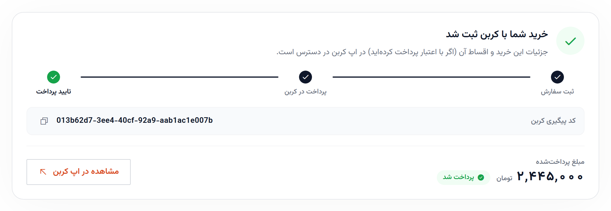
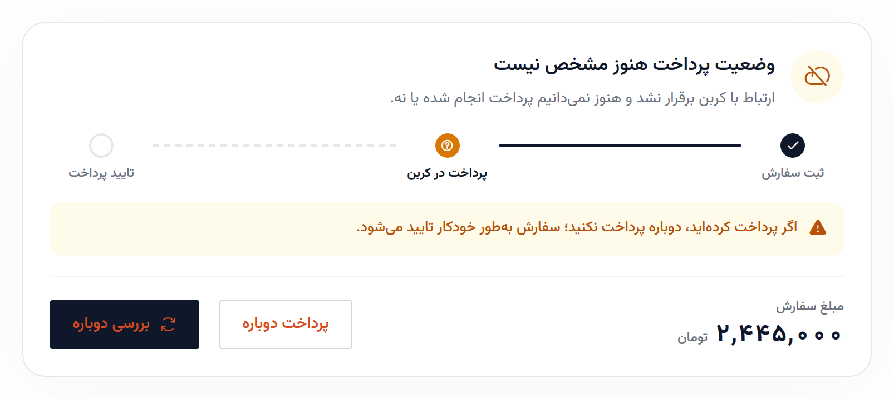
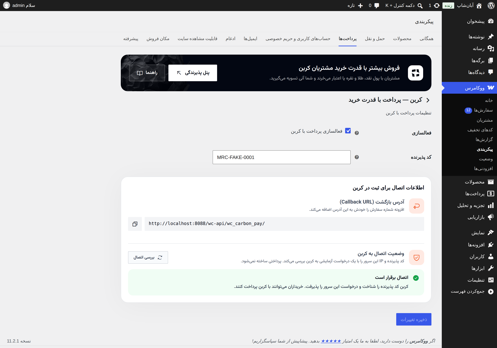
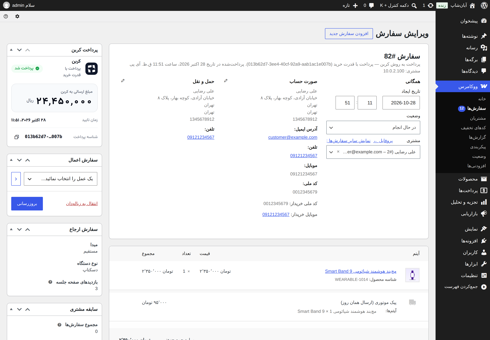
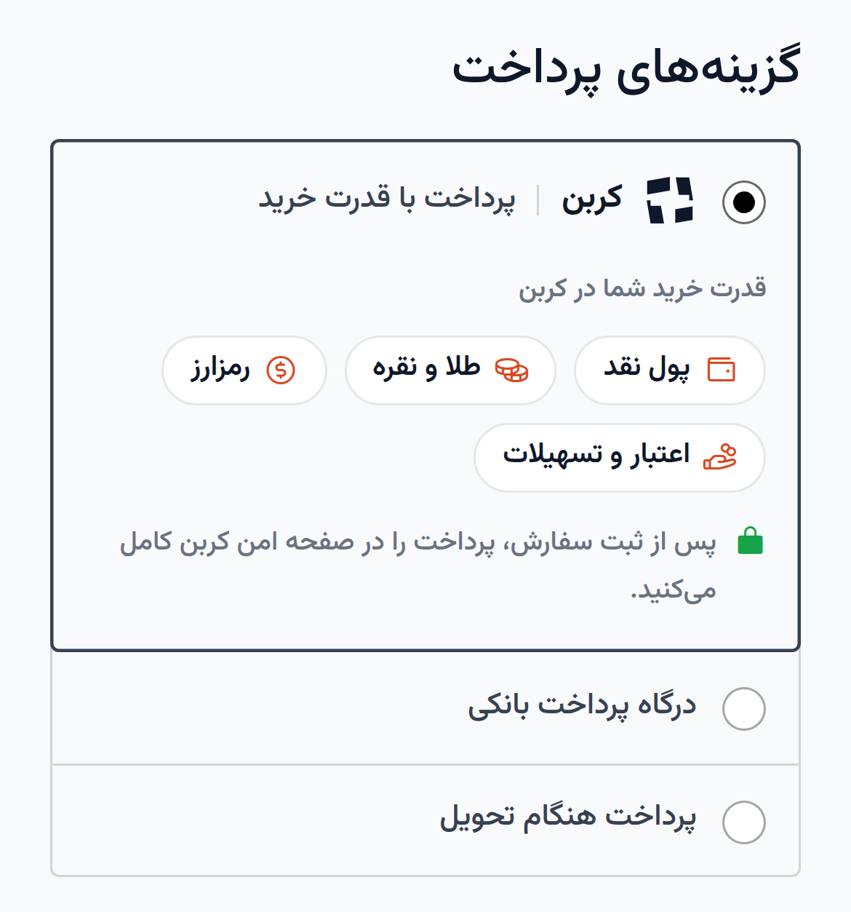
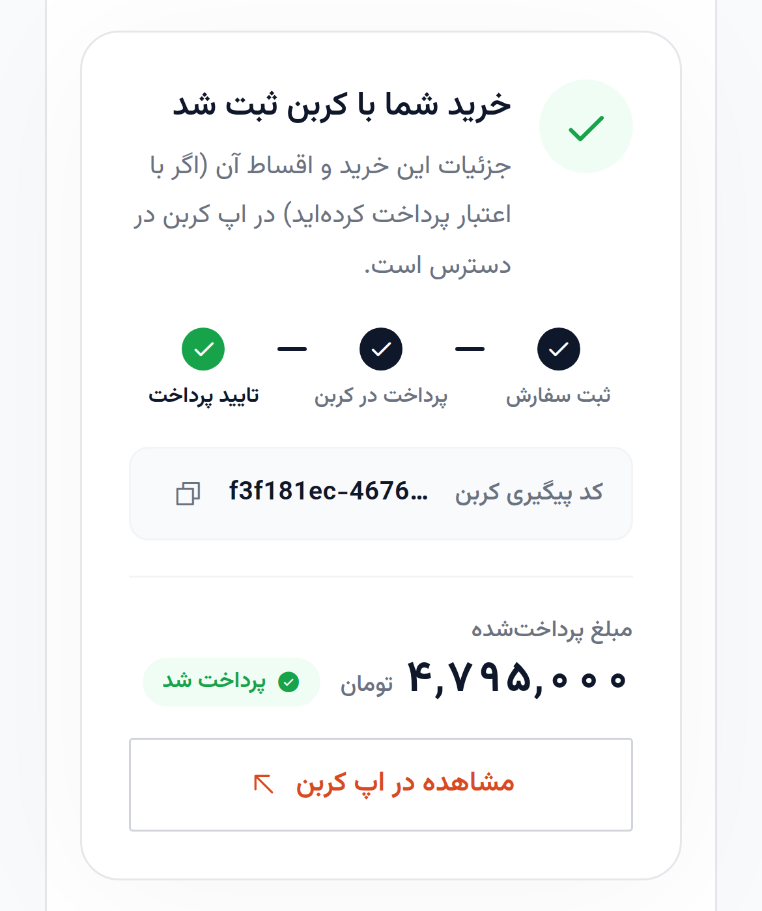

<p align="center">
  
</p>

<h1 align="center">
  <picture>
    <source media="(prefers-color-scheme: dark)" srcset=".github/images/carbon-mark-white.svg">
    
  </picture>
  Carbon Pay for WooCommerce
</h1>

<p align="center">
  <strong>Let your customers pay with their Carbon purchasing power: cash, gold and silver, crypto, credit and instalments.</strong><br>
  <span dir="rtl">افزونه پرداخت کربن برای ووکامرس — پرداخت با قدرت خرید</span>
</p>

<p align="center">
  
  
  
  
  
  
</p>

<p align="center">
  <a href="#features">Features</a> ·
  <a href="#screenshots">Screenshots</a> ·
  <a href="#installation">Installation</a> ·
  <a href="#faq">FAQ</a> ·
  <a href="#for-developers">Developers</a> ·
  <a href="https://carbon.ir">carbon.ir</a>
</p>

---

Carbon Pay connects your WooCommerce store to the **Carbon payment gateway (CPG)**. At checkout, customers pay with their Carbon purchasing power, which combines cash, gold and silver holdings, crypto, and Carbon credit or instalments. You get paid right away.

The plugin is built for Iranian stores. It has a Persian, right-to-left interface, supports Rial and Toman, and works with both the classic and the block checkout.

## Features

| | |
|---|---|
| 🛒 **Classic and block checkout** | A native Carbon payment option in both checkouts. The place-order button changes to «پرداخت با کربن» when Carbon is selected. |
| 🔒 **Safe payment results** | The result always comes from Carbon's verify API. A query string can never mark an order as paid or cancel an order that was paid. |
| 🧭 **One clear result screen per outcome** | Paid, pending (re-checked automatically), status unknown, cancelled, expired and failed. Each one shows where the payment stopped and whether money left the customer's account. None of them invites a double charge. |
| ✅ **Inline payer errors** | Mobile and national-code mismatches (Shahkar), inquiry outages, minimum amounts and non-Persian names are shown next to the field. Merchant-side errors are logged and never shown to customers. |
| 🔌 **One-click connection check** | Checks your merchant code and server IP whitelist against Carbon before you go live, without creating a payment. |
| ⚡ **HPOS compatible** | Works with WooCommerce High-Performance Order Storage. All order data goes through the order API. |
| 🔁 **Migrates from GSMPay** | Moves settings and orders over automatically, and payments that were in progress still complete. |
| 🎨 **Fits any theme** | One scoped stylesheet with no `!important`. It works on light and dark storefronts and in RTL. The Vazirmatn font and Phosphor icons are bundled, with no CDN. |

## Screenshots

<table>
  <tr>
    <td width="50%" valign="top">
      
      <p align="center"><sub><b>Checkout.</b> The customer's Carbon purchasing power, right in the payment options.</sub></p>
    </td>
    <td width="50%" valign="top">
      
      <p align="center"><sub><b>Hand-off.</b> A short countdown to Carbon's secure payment page, with a button to continue now.</sub></p>
    </td>
  </tr>
  <tr>
    <td width="50%" valign="top">
      
      <p align="center"><sub><b>Paid.</b> The payment journey, the Carbon reference with a copy button, and the amount paid.</sub></p>
    </td>
    <td width="50%" valign="top">
      
      <p align="center"><sub><b>Status unknown.</b> "Check again" is the main action, so customers who already paid don't pay twice.</sub></p>
    </td>
  </tr>
  <tr>
    <td width="50%" valign="top">
      
      <p align="center"><sub><b>Settings.</b> Merchant code, the return URL to register, and the connection check.</sub></p>
    </td>
    <td width="50%" valign="top">
      
      <p align="center"><sub><b>Order screen.</b> The «پرداخت کربن» box with the payment status, the amount sent and the payment ID.</sub></p>
    </td>
  </tr>
</table>

<p align="center">
  
  &nbsp;&nbsp;
  
  <br><sub><b>Mobile.</b> The checkout and result screens are designed for phones first.</sub>
</p>

## Requirements

| | |
|---|---|
| WordPress | 6.4 or later, tested up to 7.1 |
| WooCommerce | 8.9 or later, tested up to 11.2 |
| PHP | 7.4 – 8.5 |
| Store currency | IRR, IRT, IRHR or IRHT. The gateway hides itself for any other currency. |
| Carbon | An active gateway (merchant code) in the [Carbon merchant panel](https://carbon.ir), with your server's IP whitelisted |

## Installation

1. Install **Carbon Pay for WooCommerce** from **Plugins › Add New**, or upload the release zip, and activate it. WooCommerce must be active.
2. Go to **WooCommerce › Settings › Payments** and open **کربن — پرداخت با قدرت خرید**.
3. Enter your **merchant code** (کد پذیرنده).
4. In the Carbon merchant panel, register the **return URL** shown in the settings, plus your server's outgoing IP.
5. Press **بررسی اتصال** (check connection) to confirm that Carbon accepts the merchant code and the IP.

Errors that customers should not see (merchant code, IP whitelist, server errors) are logged under **WooCommerce › Status › Logs**, source `carbon-pay`.

> **Upgrading from GSMPay?** Activate Carbon Pay first, then deactivate `gsmpay-woocommerce`. Settings and orders move over automatically. See [docs/migration.md](docs/migration.md).

## FAQ

<details>
<summary><b>Why doesn't Carbon Pay appear at checkout?</b></summary>

The gateway only appears when it is enabled, a merchant code is set, and the store currency is IRR, IRT, IRHR or IRHT.
</details>

<details>
<summary><b>Customers see "Could not connect to Carbon".</b></summary>

Usually the merchant code is wrong or your server's IP is not whitelisted in the Carbon merchant panel. Press **بررسی اتصال** in the settings to find out which. The details are logged under **WooCommerce › Status › Logs**, source `carbon-pay`.
</details>

<details>
<summary><b>Can I refund a Carbon order from WooCommerce?</b></summary>

No. Refunds are handled with Carbon directly. WooCommerce can still record a manual refund on the order.
</details>

<details>
<summary><b>Can I change the payment method's title or description?</b></summary>

No. Customers see the same Carbon name and copy in every store, so the title and description are fixed.
</details>

## Privacy and external services

This plugin calls the Carbon API at `https://api.carbon.ir` to create and verify payments. It sends your merchant code; the order number, date, total and line items; your store's return URL; and the customer's first name, last name, mobile number and national ID code, which Carbon needs to identify the payer. See the **External services** section of [readme.txt](readme.txt) and Carbon's [terms and conditions](https://carbon.ir/fa/terms-and-conditions).

## For developers

```bash
composer install                # PHPUnit, Brain Monkey, Mockery
vendor/bin/phpunit              # unit tests (PHP 7.4 – 8.5)
npm test                        # JS unit tests (Node 22+)
tests/integration/run.sh        # WordPress + WooCommerce smoke test in Podman/Docker
bin/build-zip.sh                # dist/carbon-pay-for-woocommerce-<version>.zip
```

The plugin always uses `https://api.carbon.ir`. To point it at another Carbon API:

```php
add_filter('carbon_pay_api_base', fn () => 'https://stage-api.carbon.ir');
```

| Filter | Default | Use |
|---|---|---|
| `carbon_pay_api_base` | `https://api.carbon.ir` | Carbon API base URL |
| `carbon_pay_token_ttl` | `1200` | Payment token lifetime in seconds |
| `carbon_pay_http_client` | `WpHttpClient` | Inject your own `Api\HttpClient` |
| `carbon_pay_settings_links` | carbon.ir | Merchant-panel and docs links in the settings header |
| `carbon_pay_form_fields` | enabled, merchant code | Gateway settings fields |
| `carbon_pay_icon` | `assets/logos/carbon-pay-icon.svg` | Gateway icon in wp-admin |

| Document | |
|---|---|
| [docs/architecture.md](docs/architecture.md) | Payment flow, code layout, hooks, known limitations |
| [docs/development.md](docs/development.md) | Local setup, manual test checklist, release |
| [docs/migration.md](docs/migration.md) | What the GSMPay → Carbon Pay migration changes |
| [docs/publishing.md](docs/publishing.md) | WordPress.org submission checklist |
| [readme.txt](readme.txt) · [docs/readme-fa.txt](docs/readme-fa.txt) | WordPress.org readme (English) · Persian source for the fa_IR translation |
| [CHANGELOG.md](CHANGELOG.md) | Release notes |

`.wordpress-org/` holds the plugin directory banner, icon and screenshots (the SVN `assets/` folder). It is not included in the release zip.

## Credits

- [Vazirmatn](https://github.com/rastikerdar/vazirmatn) font by Saber Rastikerdar and contributors, SIL Open Font License 1.1
- [Phosphor Icons](https://phosphoricons.com), MIT License

## License

[GPL-2.0-or-later](https://www.gnu.org/licenses/gpl-2.0.html) © [Carbon](https://carbon.ir)
